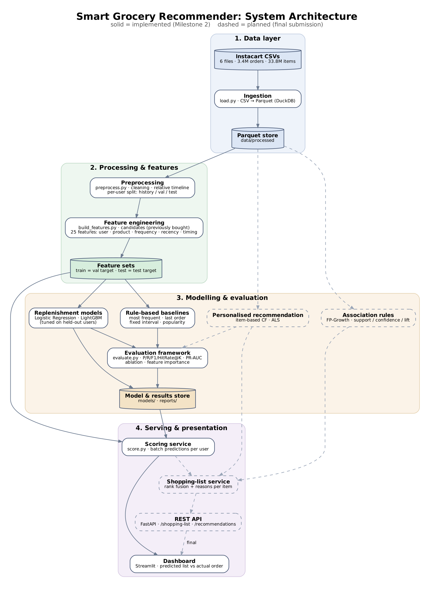

# System Architecture

Solid boxes are implemented (Milestone 2). Dashed boxes are planned for the final submission.
Source: `architecture.dot` (render with `dot -Tpng -Gdpi=150 docs/architecture.dot -o docs/architecture.png`).

## Layers

| Layer | Component | Implementation | Purpose |
|---|---|---|---|
| 1. Data | Ingestion | `src/data/load.py` | Converts the 6 Instacart CSVs to Parquet with DuckDB, giving fast, compact columnar storage |
| 2. Processing | Preprocessing | `src/data/preprocess.py` | Drops unlabelled orders, rebuilds each user's relative day timeline, splits each user's orders into history / val (second-last) / test (last) |
| | Feature engineering | `src/features/build_features.py` | Candidates = every previously bought item; 25 features in 5 groups (user, product, frequency, recency, timing); two leakage-free feature sets |
| 3. Modelling | Baselines | `src/models/baselines.py` | Most frequent, last order, fixed interval, popularity |
| | Replenishment models | `src/models/train.py` | Logistic Regression and LightGBM, trained on the val target; early stopping and threshold chosen on 10% held-out users |
| | Evaluation | `src/models/evaluate.py`, `ablation.py` | P / R / F1 / Hit Rate @K, ROC-AUC, PR-AUC; feature-group ablation; feature importance |
| 4. Serving | Scoring service | `src/models/score.py` | Batch-scores every user's candidates with the trained model |
| | Dashboard | `src/app/dashboard.py` | Streamlit: predicted shopping list with reasons vs the user's actual next order |

## Planned for final submission

- **Personalised recommendation** (item-based CF, ALS) for the ≈ 41% of next-order items that are new to the user.
- **Association rules** (FP-Growth) for "frequently bought together" suggestions.
- **Shopping-list service** that fuses replenishment, CF and rule scores into one ranked, explainable list.
- **FastAPI REST layer**, with the dashboard calling the API rather than reading files (API-first design), plus latency / throughput testing (RQ5).

## Key design decisions

- **Time-based split per user** (history → val → test) so no future information reaches training.
- **Train on the val target, test on the test target**; all tuning uses held-out training users, never the test set.
- **DuckDB + Parquet** to process 33.8M rows on a laptop without a database server.
- **Batch scoring** for the demo: predictions are precomputed, so the dashboard responds instantly.
